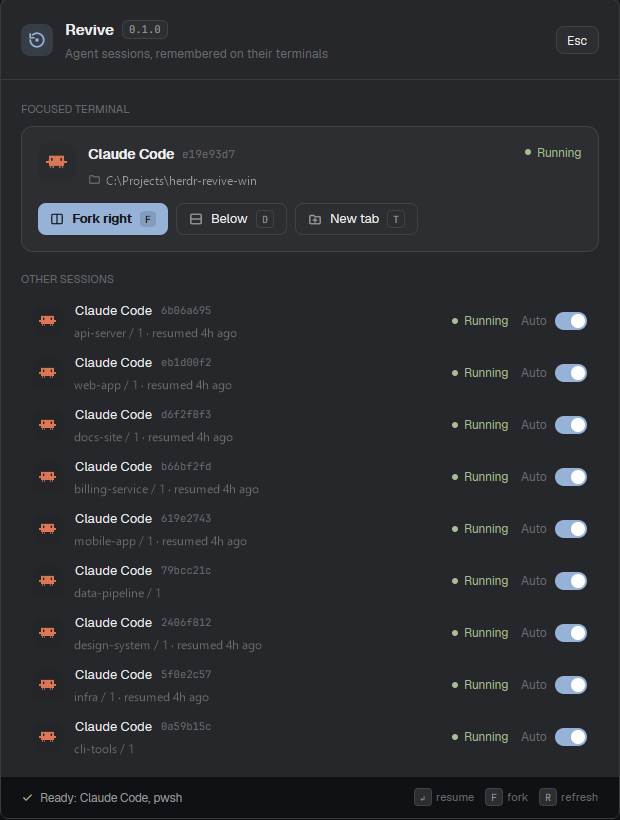

# Revive for Windows

Bring your Claude Code, Codex and pi sessions back in the **Herdr desktop app on Windows** after a reboot, a logout or a herdr-core crash.



When herdr-core loses a terminal, it gives the pane a fresh PowerShell in its last folder and never runs the original command again. Revive remembers each Claude Code, Codex and pi session on its terminal. When that terminal's new shell starts, Revive runs `claude --resume <id>` (or `codex resume <id>`, or `pi --session <id>`) in it, in the same folder and with the same safe launch flags, and your conversation is back.

> This is a Windows build of [dmazlum/herdr-revive](https://github.com/dmazlum/herdr-revive) (macOS and Linux). It is provided as is, without warranty or support; issues are welcome but may not be answered.

## What it does

- **Remembers** each interactive Claude Code session in a Herdr terminal, from Claude Code's `SessionStart` hook, each Codex session at its first message, and each pi session when pi starts (through a small pi extension).
- **Forgets** a session you end yourself (`/exit`, or `/quit` in pi). It keeps one that was cut off by a reboot, a logout or a core crash.
- **Resumes** it in the recovered terminal at the first prompt and prints `↻ Revive  resuming Claude Code session 9e458eb4`.
- **Leaves out** `--dangerously-skip-permissions`, Codex's `--yolo` and other approval-lifting flags on an automatic resume. A resume you start from the dialog keeps them.
- **Tries once:** a resume that fails within 15 seconds is not tried again at every start.
- **Dialog** (`ctrl-shift-r`): lists remembered sessions, resumes one by hand, forks the focused session right, below or into a new tab, and remembers sessions that were running before Revive was installed.

## Requirements

- Windows 10 or 11 with the Herdr desktop app (herdr-core's `hc` on `PATH`)
- PowerShell 7 (`pwsh`): [aka.ms/powershell](https://aka.ms/powershell). Windows PowerShell 5.1 is not supported.
- Node 20 or later on `PATH`
- Claude Code (the native installer or npm), Codex (npm), pi (npm), or any of them

## Install

### The easy way: ask Herdr's agent

In Herdr, open an agent and say:

> Add the Herdr mod from github.com/RAF1337/herdr-revive-win.

It copies `mods\revive-win` into your Herdr mods folder, merges `keys.json` into yours (it asks before replacing a key you already use), and checks the mod. Then press `ctrl-shift-r` and click **Install** in the dialog's footer. From then on, every new Claude Code, Codex and pi session in Herdr is remembered. Claude Code sessions that were already running show a **Remember** button in the dialog.

### By hand

1. Copy `mods\revive-win` to `%USERPROFILE%\.config\herdr-app\mods\revive-win`.
2. Run `herdr-app check %USERPROFILE%\.config\herdr-app\mods\revive-win`.
3. Add `"ctrl-shift-r": "mod.open:revive-win"` to the `global` section of `%USERPROFILE%\.config\herdr-app\keys.json`.
4. Run `node %USERPROFILE%\.config\herdr-app\mods\revive-win\revive.mjs install`. This adds a `SessionStart` and a `SessionEnd` hook group to `%USERPROFILE%\.claude\settings.json` (if `%USERPROFILE%\.claude` exists), after your own groups, and a block to your PowerShell 7 profile (created if missing). If `%USERPROFILE%\.codex` exists, it also sets up Codex: see [Codex](#codex). If `%USERPROFILE%\.pi\agent` exists, it also sets up pi: see [pi](#pi). The first change to each file keeps its original as `<file>.revive-backup`.
5. Run `node …\revive.mjs doctor` to see what is in place.
6. Sessions that were already running are not remembered yet: `node …\revive.mjs adopt --dry-run` lists them, and `adopt` remembers them.

Optional: `restore_screen = true` in `%APPDATA%\herdr-core\config.toml` shows Claude's last screen above the resumed session.

## Uninstall

Run `node %USERPROFILE%\.config\herdr-app\mods\revive-win\revive.mjs uninstall`. It takes Revive's hooks, its Codex setting, its pi extension and its profile block out again, and deletes the profile if Revive created it. Then delete the `mods\revive-win` folder and the `ctrl-shift-r` line in `keys.json`.

## Known limits

- Claude Code, Codex and pi only, in PowerShell 7 terminals on this computer.
- Claude Code starts about 2.5–3 seconds slower, and Codex's first message takes about as much longer, because the start hook reads the process list through PowerShell.
- The dialog's list takes about 3 seconds to fill.
- Sessions that started before Revive was installed may not notice `/exit`; close the pane to drop one for sure.
- A session with no message yet has nothing to resume.
- Codex and pi sessions that were running before Revive was installed aren't remembered (no **Remember** for them); start them again.

## Codex

Codex hands its sessions to a shared background server unless told not to, and that server runs Codex's hooks outside your terminal. Revive then can't tell which pane a session belongs to, and never hears that it ended. So Revive keeps Codex off that server in two ways.

**In Herdr terminals, `codex` runs with `--no-daemon`.** Revive's PowerShell block wraps the `codex` command there, so `codex`, `codex --yolo` or `codex "fix it"` start as `codex --no-daemon …`. Subcommands that don't start a session (`exec`, `login`, `mcp`, …) run as typed, and Revive's own `codex resume` and `codex fork` always carry `--no-daemon`. Outside Herdr, `codex` is untouched.

**Install changes one thing in Codex itself.** It adds this line under `[features]` in `%USERPROFILE%\.codex\config.toml` (or `%CODEX_HOME%\config.toml`):

```toml
daemon_auto_start = false # added by Revive (herdr-revive-win)
```

It stops Codex from starting that background server by itself. It doesn't stop a Codex from joining one that is already running (started by the Codex desktop app, an editor, or a Codex from before you installed Revive); that is what `--no-daemon` in Herdr terminals is for.

**What it costs:** each Codex you start runs on its own instead of sharing one background server, as Claude Code always does.

**How you're told:** install prints it, the dialog shows it after **Install**, and `doctor` reports `codexDaemon` (`off`, `on`, or `null` without Codex).

**How to undo it:** run `uninstall`, which removes only Revive's line. Or set `daemon_auto_start = true` under `[features]` yourself: Revive never changes a value you wrote, but Codex sessions are then not remembered, and the dialog says so. Deleting the line doesn't last, because the next update adds it back.

If Herdr starts Codex for you without PowerShell (not by typing `codex` in a terminal) while a background server is running, that session isn't remembered; the dialog says so when you open it on that pane. Start it as `codex` in the terminal, or with `codex --no-daemon`.

Also good to know: Codex records a session at its first message, so a Codex you open and leave empty isn't remembered. Codex asks you to trust Revive's hooks the next time it starts. `/exit` forgets a Codex session; closing its pane or a crash keeps it.

## pi

pi has no hooks file, so Revive uses a pi extension. Install writes one small file, `%USERPROFILE%\.pi\agent\extensions\herdr-revive.ts` (or under `PI_CODING_AGENT_DIR`), that loads Revive's extension from the mod folder. It needs no admin rights, and Revive doesn't touch pi's `settings.json`. A file of yours with that name is left alone, and install says so.

pi loads the extension the next time it starts, or at `/reload`. `/quit` (or Ctrl+C twice, or Ctrl+D) forgets a pi session; closing its pane or a crash keeps it. `uninstall` deletes the file. If pi's folder doesn't exist yet (pi never ran), run pi once and then `install` again.

## Settings

| Setting | Effect |
| --- | --- |
| `REVIVE_AUTO=0` | Shells with it set never resume automatically |
| `REVIVE_DEBUG=1` | The profile block says why it did or didn't resume, on stderr |
| `REVIVE_HC` | The `hc` the engine and the block use (default: `hc` on `PATH`) |

If a session doesn't come back, run `$env:REVIVE_DEBUG='1'; pwsh` in its pane to see why.

## How it works

See [RECIPE.md](RECIPE.md): what you see, how it behaves, what it is built from, and the Windows details under "Watch out".

## Development

`npm test` runs the suite. On Windows the runner gives it a scratch home, AppData and PowerShell profile, and no way to reach your herdr-core; the original's POSIX-only tests are skipped there. `npm run e2e:win` runs the end-to-end test against an isolated herdr-core.

## Credit and license

Revive is by [Devrim Mazlum](https://github.com/dmazlum/herdr-revive); this Windows build is by René Frandsen. MIT licensed: see [LICENSE](LICENSE).
