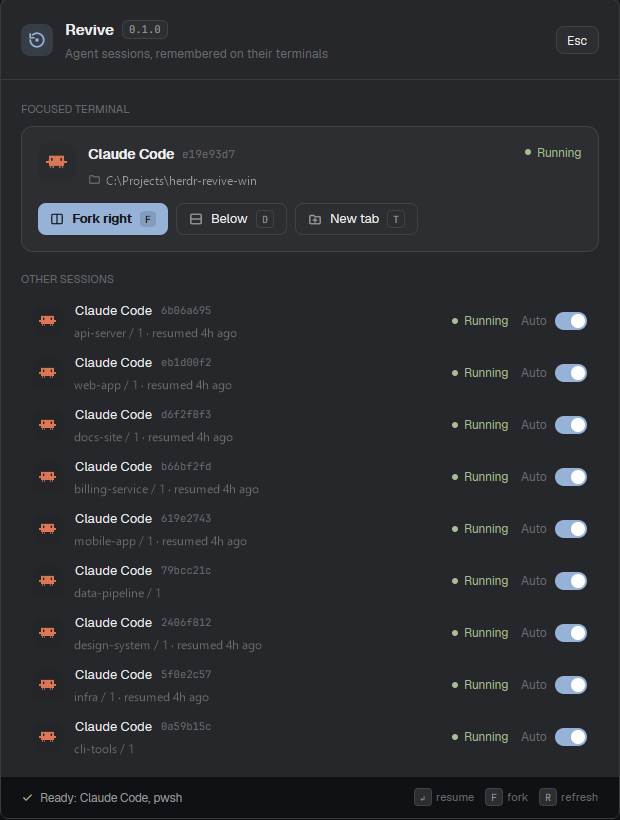

# Revive for Windows

Revive for Windows brings back the Claude Code, Codex or pi session a Herdr desktop-app terminal lost to a reboot, a logout or a herdr-core crash: in the same pane, in the same folder, with the same conversation and safe launch flags. Its dialog (`ctrl-shift-r`) lists remembered sessions, resumes one by hand, and forks the focused session into a new pane beside it. It is an unofficial, temporary Windows build of [dmazlum/herdr-revive](https://github.com/dmazlum/herdr-revive) (macOS and Linux), and supports Claude Code, Codex and pi in PowerShell 7 terminals only.

## Installing it (for the agent doing it)

This is the Windows build. It supports Claude Code, Codex and pi in the Herdr desktop app's terminals, which run PowerShell 7 (herdr-core's default shell on Windows). See *Windows* at the end for how it differs.

1. Read every file in this repository before copying anything.
2. Copy `mods\revive-win` to `%USERPROFILE%\.config\herdr-app\mods\revive-win`, as a copy, not a link.
3. Run `herdr-app check %USERPROFILE%\.config\herdr-app\mods\revive-win`. It must pass.
4. Merge `keys.json` into `%USERPROFILE%\.config\herdr-app\keys.json`. Ask the person first if `ctrl-shift-r` is already bound.
5. Tell the person what `install` changes and ask before running it:
   `node %USERPROFILE%\.config\herdr-app\mods\revive-win\revive.mjs install`. It adds a
   `SessionStart` and a `SessionEnd` hook group to `%USERPROFILE%\.claude\settings.json`
   (only if `%USERPROFILE%\.claude` exists), after the person's own groups. It adds a block to
   PowerShell 7's profile (`$PROFILE.CurrentUserCurrentHost`, asked from `pwsh`), creating the
   file if it is missing. If `%USERPROFILE%.codex` exists, it adds the same hooks to
   `.codexhooks.json` and turns Codex's shared background server off with
   `daemon_auto_start = false` under `[features]` in `.codexconfig.toml` (a setting the
   person wrote stays); Codex asks to trust the new hooks at its next start. If pi's folder (`PI_CODING_AGENT_DIR`, else `%USERPROFILE%\.pi\agent`) exists, it writes Revive's pi extension stub to `extensions\herdr-revive.ts` there; pi loads it at its next start or `/reload`. It keeps the
   original of each file as `.revive-backup`. It wires no other agent on Windows.
   `uninstall` takes all of it out again, and removes a profile it created.
6. Run `node %USERPROFILE%\.config\herdr-app\mods\revive-win\revive.mjs doctor` and report what it shows
   (`claude`, `codex`, `codexDaemon`, `pi`, `shell.pwsh`, `pwshInstalled`, `hc`, `core`, `coreShell`, `restoreScreen`, `unremembered`).
7. New sessions are remembered from now on. Sessions already running are not: `install` and
   `doctor` (`unremembered`) say how many `adopt` could remember. If there are any, run
   `revive.mjs adopt --dry-run`, show the person what it lists, and run `adopt` if they want.

## Updating it (for the agent doing it)

The dialog checks this repository's releases once a day and offers the prompt that updates it. To update:

1. Replace the installed folder (normally `%USERPROFILE%\.config\herdr-app\mods\revive-win`) with the release's `mods\revive-win`, in place, keeping the folder's name.
2. Run `herdr-app check` on the folder. It must pass.
3. Run `revive.mjs doctor`. The hooks and the profile block point at the same folder, so they keep working. If `doctor` shows something missing (from 0.2.0 on: Codex's hooks and `codexDaemon`; from 0.3.0 on: `pi`), tell the person what `install` would change and ask before running it.

## What you see

- **Dialog** (`mod.open:revive-win`, 620px wide, as tall as its content, on `popover`). Every
  color is a theme token, so it follows light and dark themes; a tint is the token with a
  two-digit hex alpha, as Herdr's own mods do. The sessions scroll once the dialog would
  pass 85% of the window; the header, the update strip, the note and the footer always
  show. Icons are Lucide-style strokes in `mods/revive-win/icons/`, drawn in the text color.
  - **Header** (20px at the sides, 18px above, 16px below): a 32px tile, 9px radius, in
    `accent` at 16%, with the logo (`icons/logo.svg`) in `accent`; **Revive** (15px
    semibold) and the installed version in a 10.5px mono chip on `raised` with a
    `border`; *Agent sessions, remembered on their terminals* (12px `dim`) under them;
    an outline **Esc** button on the right that closes the dialog. A 1px `border` line
    under the header (and under the strips when they show).
  - **Came-back strip**, when sessions came back lately (`cameBack` in `lib/core.js`:
    still running, resumed less than 15 minutes ago, automatically or from the dialog):
    20px in from the sides, 12px radius, `ansi2` at 12% with an `ansi2` 35% border. A
    28px tile with the logo in `ansi2`; **3 sessions came back** (13px semibold) and *2m
    ago* (`dim`); under them *Codex in api / 1, pi in web / 2, Claude Code in infra / 1*
    (up to three, then *and N more*, 11.5px `muted`); a *Dismiss* link on the right. Dismiss
    saves the newest resume's time in shared state (`revive.cameBack`); a batch no newer
    than that isn't shown again. It shows above the update strip. Revive can't post this
    as a notification: a mod runs only while one of its copies is in the shown layout, and
    a shipped layout takes no new blocks, so it waits for the dialog.
  - **Update strip**, when a newer release is out (see *Update check*): 20px in from the
    sides, 12px radius, `accent` at 7% with an `accent` 28% border. A download icon,
    **Revive v0.7.0 is out** (13px semibold), *you have 0.6.0* (`dim`), a *Stop checking*
    link on the right; the prompt in an 11px mono box on `background`, cut with an
    ellipsis, with a small solid **Copy** button; *Paste it to your agent.* (`dim`), and
    on the right *What changed* (in `accent`, opens the release page) and *Later*.
  - Sections, titled in 11px medium `dim` capitals, 18px above each title:
    - **FOCUSED TERMINAL**: a `raised` card with a `border`, 12px radius, 16px padding.
      The agent's tile (38px, see *Agent tiles*), its name (14px semibold), the first 8
      characters of the session id (11px mono `dim`), the folder with a folder icon
      (12px `muted`, the home folder as `~`), and the state on the right (*States*). The
      carried flags as mono chips on `background`, one per flag with its values. Notes
      in 12px `dim`. Buttons: for a running agent that forks, a solid **Fork right** `F`
      and outline **Below** `D` and **New tab** `T`, each with its icon and key; for one
      that needs you, a solid **Resume** `↵`, and **Copy command** when it can only be
      resumed by hand. For a running agent that can't fork (Cursor): no fork buttons,
      and *Cursor can't fork a session.* A Claude Code session with no transcript yet
      can't be forked: the Fork buttons are disabled, F/D/T do nothing, and the card says
      *This session has no message yet, so there is nothing to fork. Send it one first.*
      A session that ran with something Revive doesn't carry (see *Config folders*)
      can't be forked from the dialog either: *It ran with CLAUDE_CONFIG_DIR: fork it
      from its own shell.* Neither can one whose folder failed the check: *Its folder is
      missing, not yours, or writable by others.* A session started before Revive was
      installed says it can be forked but won't come back by itself; for Claude Code, *…
      until you remember it*, with an outline **Remember** after the Fork buttons
      (`revive.mjs adopt T`; *Remembering…* while it runs, and the engine's reason in the
      note line when it won't). With no message yet it says *nothing to fork or remember*
      and **Remember** is disabled too; when the engine can't tell the folder it started
      in, *Revive can't remember it:* and the engine's reason (`rememberWhy`). No key: `R`
      is Refresh. An agent running
      with nothing on record gets the same card without an id or buttons, and a note
      that Revive has no record of it, so it can't be forked or brought back; for Codex
      the note adds that Codex records a session at its first message, and not at all
      while its shared background server runs it (`daemon_auto_start`).
      Without an agent: a dashed `border` card with a terminal icon, *No agent in this
      terminal* and *Start one here and Revive remembers it from its first message.*
      (*Looking…* until the first list). On another machine: the same card, *The focused
      terminal is on another machine* and *Revive works on this computer for now.*
    - **NEEDS YOU**, with a count in an `ansi3` pill: other terminals whose session is
      lost, interrupted or failed. Each row (54px, 10px radius, `raised` with a
      `border`, `hover` on hover, 4px apart): the agent's tile (30px), its name (13px
      medium) and short id, *space / tab · resumed 3m ago* in `dim`, the state, **Auto**
      with a switch, and a small solid **Resume**. Clicking the row closes the dialog and
      focuses that terminal.
    - **OTHER SESSIONS**: the rest, the same rows (50px) without the fill, border or
      **Resume**, 2px apart. A session found through its pid but not remembered says
      *not remembered* instead of the switch, and, when the engine says it can be
      (`rememberable`), a small ghost **Remember** that does what the card's does.
  - **Nothing at all** (no session remembered anywhere, no agent in the focused
    terminal): in place of the sections, centered, a 52px `raised` tile with the logo in
    `muted`, **No sessions remembered yet** (14px semibold), *Start an agent in a Herdr
    terminal. Revive remembers its session at the first message and brings it back after
    a reboot or a core restart.* (12.5px `dim`), and a chip with its tile and name for up
    to four installed agents (*+N more* after them).
  - A note line for errors (`ansi1`, on `ansi1` at 8%) or install output (`muted`), 8px
    radius, above the footer.
  - **Footer**, under a `border` line, on `chrome`: when everything is installed, a check
    in `ansi2` and *Ready: Claude Code, Codex, pi, zsh* (each installed agent, then each
    shell with the block) in `muted`; keys on the right (not in the empty state, where there is nothing to resume or fork): `↵` resume, `F` fork, `R`
    refresh. When something is missing: on `ansi3` at 7% with an `ansi3` 25% line, an
    alert icon in `ansi3`, **Setup isn't complete** and what's missing (*pi extension
    missing · shell block missing*), and a small solid **Install**.
  - **States**: *Running* in `ansi2`, *Lost to a restart* and *Interrupted* in `ansi3`,
    *Resume failed* in `ansi1`. A 6px dot and the word (11.5px medium); for the ones
    that need you, on a 22px pill of the same color at 12%.
  - **Agent tiles**: the agent's own icon from Herdr's program table (`knownAgents()`,
    looked up by the agent's key, then its program and report names): `svg(icon)` in
    its `color` when `tint`, else `image(icon)`, on its `tile` color at 18%, or on
    `foreground` at 12% when it has none. 27% radius. An agent Herdr doesn't list (or a
    Herdr without `knownAgents`) gets its initial in `muted` on the same tile.
  - **Switch**: 32×18, a 14px white knob; `accent` when on, `foreground` at 18% when off.
  - **Buttons**: solid on `accent` with `accent_foreground` (semibold), outline on
    `raised` with a `border`, 8px radius, 32px tall (28px small), the key in a 10px mono
    chip.
- The list refreshes every 4 seconds while the dialog is open.
- In a resumed pane, before the agent starts, one line in ANSI's own colors (so it follows
  the terminal's theme): `↻ Revive` in bold blue, `  resuming `, the agent's name in
  bold, ` session 9e458eb4`, and ` · REVIVE_AUTO=0 skips this` dim. When flags that lift
  approvals or the sandbox were left out, a second line in yellow: `  without
  --dangerously-skip-permissions (only a resume from the Revive dialog keeps it)`.
  Both are `printfLine` (`lib/core.js`): the texts are `printf` arguments, never its
  format.

## How it behaves

### The record

A session is remembered as labels on its herdr-core terminal:

| Label | Value |
| --- | --- |
| `revive.agent` | `claude`, `codex`, `pi`, `omp`, `droid` or `cursor` |
| `revive.session` | The session id |
| `revive.cwd` | The folder the session ran in |
| `revive.flags` | The carried launch flags, as a JSON array |
| `revive.needs` | What the session ran with that Revive doesn't carry, as a JSON array of names, never values: the agent's config-folder variables that were set (`CLAUDE_CONFIG_DIR`, `CODEX_HOME`, `PI_CODING_AGENT_DIR`, `PI_CODING_AGENT_SESSION_DIR`) and `--session-dir` (pi, omp); absent otherwise |
| `revive.transcript` | pi and omp only: the session file the agent named |
| `revive.shell` | The pid of the terminal's program when the session started or was resumed |
| `revive.since` | That program's start time (`ps -o lstart`), so a new shell that got an old pid after a reboot is still new |
| `revive.at` | When it was recorded (ms) |
| `revive.resumed` | When Revive last resumed it (ms); kept until a new session starts |
| `revive.failed` | When a resume gave up within 15 seconds (ms) |
| `revive.auto` | `off` turns automatic resume off for this terminal; kept across sessions |

Labels are kept by herdr-core across its restarts and go away with the terminal.

Anything that can talk to herdr-core can write them, so what is read back is checked
again: the flags go through the agent's carry list, as on the way in; `revive.needs` keeps
only names the agent declares; the folder must pass the check under *Rules*. Records from
0.4.0 are read the same way: their `revive.env` (names and values) counts only by its
names, as needs, and a `--session-dir` in their `revive.flags` counts as a need too.

### Rules

- A hook acts only for the agent in its terminal's foreground: walking up from the hook's
  process must reach the foreground pid, and the agent processes on the way (`claude`, or
  `codex` as the first or second word) must be next to each other. An agent and its
  wrapper are one agent (npm's `node …/bin/codex` running the native `codex`, a launcher
  with another name). Agent, shell, agent is a tool call: a `claude -p` an agent runs
  inherits `HC_TERMINAL_ID`, but its hooks record nothing.
- A one-shot run in the foreground (`claude -p`/`--print`, `codex exec`/`e`, `pi -p`,
  `pi --mode json|rpc`, `pi --no-session`, `omp -p`/`--print`, `omp --mode json|rpc|rpc-ui`,
  `omp --no-session`, `omp --export…`, `droid exec`, `cursor-agent -p`/`--print`)
  records nothing: it fires `SessionStart` and
  ends with reason `other`, so it would replace the interactive session on record and be
  resumed after the next restart.
- pi's extension acts only when `HC_TERMINAL_ID` is set, in pi's `tui` mode, for a session
  with a file. It sends `SessionStart` at every `session_start` (startup, `/new`,
  `/resume`, `/fork`, reload), with pi's command line as `argv` (pi renames its process
  `pi`). At `session_shutdown` it sends `SessionEnd` with reason `prompt_input_exit` only
  for `quit` without a SIGTERM or SIGHUP; a signal, or a session replaced in the same
  process, sends nothing, which keeps the record like Claude Code's `other`. It imports
  `../lib/extension.js` from its own real path, which finds the engine as
  `../revive.mjs` from there, so the extension must be linked, not copied away from the
  mod. It listens for SIGTERM and SIGHUP from its first `session_start` to the
  `session_shutdown`, once however often a session starts. The hook gives up after 10
  seconds, and a hook that fails or can't start `node` is dropped without holding up the
  next one.
- omp's extension (checked against omp 18.16.0) works like pi's, through the same
  `lib/extension.js`, and runs `revive.mjs hook --agent omp`. It differs in two ways.
  omp's `session_shutdown` carries no reason: the extension listens for SIGTERM and
  SIGHUP itself and sends `SessionEnd` with reason `prompt_input_exit` only when neither
  came first (a person's `/exit`, Ctrl+C or Ctrl+D); a reboot, a core restart or a
  closed terminal sends nothing and keeps the record. `/new`, `/resume` and `/fork`
  switch sessions in the same process and report `session_switch`, which is sent as a
  `SessionStart`. omp loads extensions only when it starts, not at a reload.
- Config folders: the hook records the names, never the values, of the agent's
  config-folder variables set in its environment (`CLAUDE_CONFIG_DIR`, `CODEX_HOME`,
  pi's `PI_CODING_AGENT_DIR` and `PI_CODING_AGENT_SESSION_DIR`, omp's
  `PI_CODING_AGENT_DIR`), and `--session-dir` when pi or omp ran with it, as
  `revive.needs`. Resume and fork run the agent with the shell's own environment and no
  variables of their own; the transcript check looks only in this process's folder. A
  session with needs resumes by itself only when the resuming shell sets each variable
  on its own, and never when it ran with `--session-dir`.
- The folder a record names is used only as the person's own: `cd` goes to its real
  path (links resolved), and only when it is an existing folder that belongs to this
  user and that others can't write to. Otherwise the record's folder is refused.
- `adopt` writes the labels a `SessionStart` would have for a running Claude Code session
  nobody recorded (one started before Revive was installed), from the agent's own process
  only: the id from its own `sessions/<pid>.json` in this user's Claude folder (as `list`
  finds it), through `validId`; the flags from its live command line, through the carry
  list; the folder it started in, from its transcript, which must pass the check above. A
  label is only asked whether a record exists: nothing in one can make adopt write
  anything, it grants nothing new, and what it writes is read back like a hook's record.
- `adopt` records Claude Code only. Droid's and Cursor's session is the newest file in
  their folder's store, a guess good enough to show but not to keep; Codex, pi and omp
  aren't found at all.
- `adopt` skips a terminal with a record, another machine's, a one-shot run, a session it
  can't find, one already on record in another terminal or found in two (it would come
  back in two panes), and one whose folder it can't tell or that fails the check.
- The folder is the one the session started in, which its hook records and `--resume`
  needs: `sessions/<pid>.json` and the terminal hold the folder it is in now, which can
  move. It is the `cwd` of the first entry in its transcript that has one, and must be
  the folder the transcript is filed under (`projects/<folder, every non-alphanumeric a
  dash>/`). It is never taken from that name, which can't be turned back into a path
  (`/a/my-proj` and `/a/my/proj` are both `-a-my-proj`). A session with no transcript has
  no message yet, so nothing to resume, and is skipped.
- `adopt` records `CLAUDE_CONFIG_DIR` as a need (by name) when it is set in its own
  environment: the session was found in the folder it names, so the agent ran with it.
  `--dry-run` prints the `hc label` it would run and writes nothing.
- The agent is known by the command line the hook sent (pi, omp), then the foreground command
  line, then the agent process the hook came from, then the hook's `--agent`, then the
  payload (its transcript path, Cursor's `cursor_version`), and only then the terminal's
  last OSC report, which may still be a previous agent's. A bare `agent` on a command
  line is no agent: Cursor's only under a path that says Cursor, or by its report. A running agent
  behind a wrapper is recognized by its report while something other than the shell is
  in the foreground.
- `SessionStart` for the remembered session id (a resume, a compaction) keeps its
  `resumed` mark and `at`; a new session id starts without.
- `SessionEnd` with a session id other than the remembered one is ignored.
- `SessionEnd` with reason `clear` or `resume` does nothing: the same process starts
  another session right away and its `SessionStart` records it; clearing could race it.
- `SessionEnd` with reason `other` (a signal) leaves the record. Any other reason
  (`prompt_input_exit` for `/exit` and Ctrl+C, `logout`, …) forgets it. Codex and Droid
  follow these, except Codex on Windows, where `other` forgets it (see Watch out). Cursor: `completed` and `user_close` forget it, any other reason keeps it.
- Hook payloads are read the same for every agent: the event with its first letter
  capitalized (Cursor's `sessionStart`), the id from `session_id` or else
  `conversation_id`, the folder from `cwd` or else `workspace_roots[0]`.
- The shell block asks `${REVIVE_HC:-hc}` for the terminal and starts node only when its
  answer has a `revive.session` label and the shell's parent is not a shell that ran the
  block (`REVIVE_SHELL`, which the block exports as its `$$`). A shell started by hand
  inside the terminal's costs one `hc get`.
- `check` resumes only when all hold: it runs in the terminal's own shell (`$$` is the
  terminal's pid, or the walk up from `$$` reaches it without passing another shell or
  `REVIVE_SHELL`: the child of a pty wrapper such as Kiro CLI's), the terminal's program is not the remembered one (another pid, or the
  same pid with another start time), automatic resume is on, the agent and the id are
  valid, the last resume did not fail (`revive.failed` is unset), the folder passed its
  check, every need is met (each variable set in the shell, never `--session-dir`), and
  (for Claude Code, pi and omp) the session's transcript exists. Without a transcript the
  record is dropped. A failed resume is not retried at every restart; **Resume** in the
  dialog still tries it.
- When only the folder or an unmet need stops it, `check` says so once (`↻ Revive` in
  bold yellow, then `  not resuming Claude Code session 9e458eb4: it was started with
  CLAUDE_CONFIG_DIR.` and, dim, ` Resume it by hand from the Revive dialog.`), and marks the terminal
  `revive.failed`, so the next shell stays quiet.
- **Resume** in the dialog refuses a record whose folder failed the check, and names the
  folder (*Won't resume: its folder ~/w is missing, not yours, or writable by others.*).
  It refuses a record with needs too, keeps the record, and names them with the command
  to copy (*Won't resume here: it ran with CODEX_HOME, which Revive doesn't carry. Set it
  and run: cd -- … && codex resume <id>*). Nothing is typed into the terminal in either
  case. Fork is disabled for both, and so is the dialog's Resume button: the card shows
  the same reason before a click, and for needs the command with a **Copy command**
  button. `unresumable(rec)` in `lib/core.js` is the one test both use.
- `list` checks the transcript only for the focused terminal's running session, the one
  whose card offers Fork. pi's and omp's is the recorded session file. For Claude Code it
  says `forkable: false` only when it is sure: the agent's `sessions/<pid>.json` is in
  this process's folder. Otherwise it says `null` and the fork is let through, since an
  agent started with a `CLAUDE_CONFIG_DIR` the app doesn't have keeps its transcripts
  elsewhere. A folder or variable named in a label is never taken as proof.
- For a running Claude Code session nobody recorded, `list` also says `rememberable`:
  true when `adopt` can tell the folder it started in, false with `rememberWhy` when it
  can't. Other agents get neither, and the dialog offers no **Remember** for them. The
  dialog's **Remember** runs `adopt T`, which checks everything again.
- `check` marks the terminal (`shell`, `since`, `resumed`) before printing, so a second
  shell can't resume the same session again.
- The shell block runs what `check` printed at the first prompt (zsh: a one-time `precmd`
  hook; bash: `PROMPT_COMMAND`), not while the rc files run. The resume runs with its
  input and output on the terminal's own device (`/dev/$(ps -o tty= -p $$)`), never
  `/dev/tty`: Claude Code's runtime crashes on macOS when its input is that alias.
- The shell block leaves `$?` at 0.
- Session ids must match `[A-Za-z0-9][A-Za-z0-9._:-]{0,127}`; anything else is refused.
  Every word of a command is shell-quoted.
- **Resume** in the dialog sends the command to the terminal with `hc send`, only when its
  foreground is the terminal's own shell, never into another running program.
- Fork opens `terminal.open {argv, folder, place}` with the agent's fork command:
  `claude … --resume <id> --fork-session`, `codex fork … <id>`, `pi … --fork <id>`,
  `omp … --fork <id>`, `droid … --fork <id>`. An agent with no fork (Cursor) gets no fork buttons or keys.
  A Claude Code session nobody recorded is forked in the folder it started in, as `adopt`
  finds it, or the one it is in now when that can't be told.
- pi's and omp's transcript check is the recorded session file: it exists, or the session never got
  a message. A record without one is let through.
- Install ends by counting the running sessions `adopt` could remember (`adopt
  --dry-run`), and says how many, pointing to `adopt`. It never adopts: it runs on every
  update and from the dialog's **Install**, and changes nothing but its own files.
  Uninstall doesn't count. In a Herdr terminal it asks `hc` only while that terminal's
  herdr-core answers (an `hc` that finds no core starts one); elsewhere (the dialog's
  **Install**) as `list` does. A failure is a warning; the install still succeeds.
- `doctor` adds the same count as `unremembered`, or null when `hc` wasn't asked or
  failed. The dialog's setup (`list --setup`) leaves it out: the dialog lists the
  sessions itself.
- Install writes an agent's hooks only into the file it reads now, and takes Revive's
  out of every other file it may be in (Droid's `settings.json` once a `hooks.json`
  exists). The shell block works the same way: one file per shell, and a bash block an
  older install left in another bash file (`.bash_profile`, `.bash_login`, `.profile`,
  `.bashrc`) is taken out when bash's is written. A file without Revive in it is never
  rewritten by install or uninstall.
- Hooks never fail an agent: every error is swallowed and the exit code is 0.
- Under `herdr-app check` (Herdr's `checking()`, 0.1.16 and later) the dialog draws but
  runs nothing: no engine, no refresh, no update check. `checking` is read from the
  `herdr` module rather than imported by name, so an older Herdr, which has no such
  export, still loads the mod.

### Update check

- Only the dialog checks, when it opens, and at most once a day: one GET to
  `https://api.github.com/repos/RAF1337/herdr-revive-win/releases/latest`, with no token and
  nothing about the person, their sessions or their folders. The engine and the hooks
  never touch the network.
- The result is kept in Herdr's shared state under `revive.update` (`checked`, `latest:
  {tag, url}`, `dismissed`, `off`, `repo`), so it lasts across restarts and every copy of
  the dialog sees it. The time is saved before asking, so two dialogs don't both ask. A
  result saved for another repository counts as never checked; `off` holds for any.
- A release is offered when its tag (`v1.2.3`) is newer than `VERSION` in
  `lib/update.js`, which must equal `package.json`'s and `mod.json`'s version (a test
  checks it). A tag of another shape offers nothing until the next day's check; a
  failed request or no network offers nothing and is tried again an hour later. A saved
  check time in the future (a clock that was wrong) counts as long ago.
- **What changed** opens the release's page only if it is on
  `https://github.com/RAF1337/herdr-revive-win/`; otherwise the releases page.
- **Later** hides that release until a newer one; **Stop checking** sets `off` for
  good. `CHECK` in `lib/update.js` is `true` in this build.
- A release bumps the version in `package.json`, `mods/revive-win/mod.json` and
  `mods/revive-win/lib/update.js`, and is tagged `v<version>`.

### Settings

| Setting | Effect |
| --- | --- |
| `REVIVE_AUTO=0` | Shells with it set never resume automatically |
| `REVIVE_DEBUG=1` | The shell block says why it did or didn't resume, on stderr |
| `REVIVE_HC` | The `hc` binary the engine and the shell block use (default: `hc` on PATH) |
| `REVIVE_TTY` | The device the resume runs on, instead of the terminal's (for tests) |
| `CLAUDE_CONFIG_DIR`, `CODEX_HOME`, `PI_CODING_AGENT_DIR`, `ZDOTDIR` | Honored when finding the files to install into; a session's own `CLAUDE_CONFIG_DIR`/`CODEX_HOME`/`PI_CODING_AGENT_DIR`/`PI_CODING_AGENT_SESSION_DIR` is recorded by name only, as a need. Without `ZDOTDIR` in the environment, `zsh -c` is asked for it (it reads `~/.zshenv`). omp, Droid and Cursor: always `~/.omp/agent`, `~/.factory` and `~/.cursor` |

Install writes through symlinks to the file they point at, keeps each file's permissions,
and copies the original to `<file>.revive-backup` only the first time. A settings file
whose Revive hooks are already right (the same command and timeout) is not written, even
when another tool reformatted it or added its own groups after Revive's: other tools (Herdr's
own Codex integration among them) rewrite `~/.codex/hooks.json` too. Each hook has a
10 second timeout, except Codex's `SessionEnd`, which gets 3: Codex clamps it to 3 and
warns at every start about anything longer.

## Built from

### The files

| File | What it is |
| --- | --- |
| `mods/revive-win/main.js` | The dialog |
| `mods/revive-win/lib/core.js` | Agents (the `AGENTS` table), flags, hook payloads, labels, states and the resume script: plain functions shared by the dialog and the engine |
| `mods/revive-win/icons/*.svg` | The dialog's icons (logo, folder, fork, copy, alert, …): Lucide-style strokes in `currentColor` |
| `mods/revive-win/lib/update.js` | Dialog only: the installed `VERSION` and the daily check for a newer release |
| `mods/revive-win/lib/sessions.js` | Engine only: finding a running agent's session from the files it writes, for one nobody recorded, and the folder a Claude Code one started in |
| `mods/revive-win/revive.mjs` | The engine, run with the person's Node: hooks, the shell check, list, resume, adopt, install |
| `mods/revive-win/lib/win.js` | Engine only, Windows: the process table from CIM, start times, the effective foreground, folder owners |
| `mods/revive-win/lib/pwsh.js` | Windows: PowerShell quoting, the resume command and script, the notes, the profile block (plain functions, like `lib/core.js`) |
| `mods/revive-win/lib/codexconfig.js` | Engine only, Windows: Revive's `daemon_auto_start = false` line in Codex's `config.toml`, added and taken out |
| `mods/revive-win/lib/extension.js` | Extensions only: what pi's and omp's extensions share (running `revive.mjs hook` one at a time, the SIGTERM/SIGHUP listener) |
| `mods/revive-win/pi/revive.ts` | pi's extension: runs `revive.mjs hook` at pi's session start and end, with Claude Code's payload |
| `mods/revive-win/omp/revive.ts` | omp's extension: the same for omp, which has its own extension folder and events |
| `mods/revive-win/package.json` | Marks the folder as ES modules for Node |
| `mods/revive-win/mod.json` | Opens as a dialog; docks nowhere |

### Agents

One entry each in `AGENTS` (`lib/core.js`), one hook target in `HOOK_TARGETS`
(`revive.mjs`; pi and omp: an extension in `EXTENSIONS`), and optionally a finder in `lib/sessions.js`: that is all an agent needs.

| Agent | Known by | Resume | Fork | Hooks installed into | Session id from | Carried flags |
| --- | --- | --- | --- | --- | --- | --- |
| Claude Code | `claude`; report `claude-code` | `claude … --resume <id>` | `claude … --resume <id> --fork-session` | `~/.claude/settings.json` | `session_id` | `--dangerously-skip-permissions`, `--allow-dangerously-skip-permissions`, `--permission-mode`, `--model`, `--agent` |
| Codex | `codex`; report `codex` | `codex resume … <id>` | `codex fork … <id>` | `~/.codex/hooks.json`, groups with `"matcher": ""` | `session_id` | `--no-daemon`, `--dangerously-bypass-approvals-and-sandbox`, `--yolo`, `--full-auto`, `--approve-for-me`, `--search`, `-m`/`--model`, `-s`/`--sandbox`, `-a`/`--ask-for-approval`, `-p`/`--profile` (a profile name only, not a path) |
| pi | `pi` as the first word only (pi renames its process `pi`); report `pi` | `pi … --session <id>` | `pi … --fork <id>` | extension linked into `~/.pi/agent/extensions/` (`$PI_CODING_AGENT_DIR/extensions/`) | `session_id` from the extension | `--provider`, `--model`, `--models`, `--thinking`, `-t`/`--tools`, `-xt`/`--exclude-tools`, `-nt`/`--no-tools`, `-nbt`/`--no-builtin-tools`, `-ne`/`--no-extensions`, `--no-mcp`, `-ns`/`--no-skills`, `-nc`/`--no-context-files`, `-a`/`--approve`, `-na`/`--no-approve`, `--offline` |
| omp | `omp` as the first word only (omp renames its process `omp`); report `omp`, `oh-my-pi` | `omp … --resume <id>` | `omp … --fork <id>` | extension linked into `~/.omp/agent/extensions/` (always that folder: a `PI_CODING_AGENT_DIR` is taken to be pi's) | `session_id` from the extension | `--model`, `--smol`, `--slow`, `--plan`, `--provider`, `--models`, `--thinking`, `--service-tier`, `--tools`, `--skills`, `--no-tools`, `--no-lsp`, `--no-pty`, `--no-extensions`, `--no-skills`, `--no-rules`, `--no-context-files`, `--no-title`, `--hide-thinking`, `--profile` (a name only), `--approval-mode`, `--auto-approve`, `--plan-yolo` |
| Droid | `droid`; report `droid` | `droid … --resume <id>` | `droid … --fork <id>` | `~/.factory/hooks.json` (event map, no `hooks` wrapper) if it exists, else `hooks` in `~/.factory/settings.json`; command `… hook --agent droid` | `session_id` | `--auto`, `--use-spec`, `--disable-builtin-skills` (interactive flags only: `--skip-permissions-unsafe`, `-m` and the reasoning/tool flags are `droid exec` only, and interactive droid reads them as the prompt) |
| Cursor | `cursor-agent`, or `agent`/`node`/`index.js` under a `cursor` or `cursor-agent` folder; report `cursor`, `cursor-agent` | `cursor-agent … --resume <id>` | none | `~/.cursor/hooks.json`: `{"version": 1, "hooks": {"sessionStart": [{"command": …}], "sessionEnd": […]}}`, no timeout; command `… hook --agent cursor` | `conversation_id`; folder from `workspace_roots[0]` | `-f`/`--force`, `--yolo`, `--model` (it has no `-m`), `--sandbox`, `--mode`, `--plan` |

Everything else on the command line is left behind: a first prompt, `--resume` itself,
a secret (`--api-key`, Cursor's `-H`). A value flag whose value is missing, looks like
another flag or isn't accepted (a profile that is not a plain name) is dropped with its
value.

#### Never carried, and why

The flags travel through a terminal label, which anything that can talk to herdr-core
can write, and they come back unattended after a reboot.

- Permission and sandbox modes are carried, but the ones that lift approvals or the
  sandbox only into a resume the person starts from the dialog. An automatic resume
  leaves them out and its dim line names them. A label writer may be an agent running
  under restricted permissions (a prompt-injected one, say): a bypass it writes into a
  label must not come back unrestricted after a reboot, with nobody watching it start.
  Left out of an automatic resume (each agent's `unattended` in `lib/core.js`):
  - Claude Code: `--dangerously-skip-permissions`, `--allow-dangerously-skip-permissions`,
    `--permission-mode` other than `default`, `manual`, `plan` or `dontAsk`
  - Codex: `--dangerously-bypass-approvals-and-sandbox`, `--yolo`, `--approve-for-me`,
    `-a`/`--ask-for-approval never`, `-s`/`--sandbox danger-full-access`
  - Cursor: `-f`/`--force`, `--yolo`, `--sandbox` other than `enabled`
  - omp: `--auto-approve`, `--plan-yolo`, `--approval-mode` (any value)
  - Droid: `--auto`
  - pi: `-a`/`--approve`
- Value flags that pick something by name take a plain name only, never a path: Codex's
  and omp's `--profile`, Claude Code's `--agent` (an agent definition, `plugin:name`
  allowed), omp's `--skills` (comma-separated names).
- Never carried: flags that make the agent load something it would not load otherwise,
  because that runs code or instructions at once on resume: settings, hooks, extensions,
  plugins or MCP servers (`--settings`, `--mcp-config`, `--plugin-dir`,
  `-e`/`--extension`, `--hook`, `--config`, `--approve-mcps`, Codex's
  `--dangerously-bypass-hook-trust`), extra instructions (`--system-prompt`,
  `--append-system-prompt`, `--append-system-prompt-file`, `--skill`) and extra folders
  (`--add-dir`, omp's `--allow-home`, Cursor's `--workspace`: Cursor loads that folder's
  rules, MCP config and hooks, and the resume already runs in the recorded folder).
- The agent's config-folder variables and `--session-dir` name the folder it loads its
  settings, hooks, extensions or sessions from. Their values are never taken from a
  label: a label could name any folder, and a check of that folder proves nothing, since
  whoever writes labels can also put a matching file there. Only their names are
  recorded (`revive.needs`; see *Config folders* under *Rules*).

A session started with one of these comes back without it; the person adds it again if
they want it.

A running agent nobody recorded is found from its files: Claude Code by
`~/.claude/sessions/<pid>.json`; Droid by the newest `<id>.jsonl` in
`~/.factory/sessions/<cwd, every non-alphanumeric a dash>/` written since the agent started;
Cursor by the newest `<id>/` (folder or its `store.db`) in `~/.cursor/chats/<md5 of the
cwd>/` written since then. Codex, pi and omp: not found. `adopt` records a Claude Code one
from the same file (see *Rules*); the others are only shown.

Checked by hand with droid 1.1.0 and cursor-agent 2026.10.22 on macOS: Droid reports
`droid` to Herdr; its SessionStart hook records the session and its flags; `droid --auto
high --resume <id>` reopens the same session id in high autonomy; `droid --fork <id>` opens
an interactive copy under a new id. Cursor's `sessionStart` fires for a new chat with a
`conversation_id` that `cursor-agent --force --resume <id>` reopens with its history;
it does not fire again when a chat is resumed, so the record a resume leaves on the
terminal carries it to the next restart. Both session-file layouts above match. Not
checked yet: Cursor's `sessionEnd` reasons for `/exit`, Ctrl+C and a shutdown, and a real
reboot with either agent.

## Watch out: Windows

This build adds Windows to upstream's macOS and Linux design. The Windows code is in `lib/win.js` (the process table) and `lib/pwsh.js` (everything written in PowerShell), plus `WIN` branches in `revive.mjs`. On macOS and Linux everything above is unchanged.

- **Process table.** Windows has no `ps`. The table comes from CIM through `pwsh` (`Get-CimInstance Win32_Process`, about 1 s). Command lines are split by the Windows rules (`CommandLineToArgvW`). Start times are kept as UTC to the millisecond (`2026-11-16T07:16:49.057Z`). Windows reuses pids and keeps a dead parent's pid on its children, so a parent that started after its child is not its parent.
- **Foreground.** On Windows, herdr-core reports the terminal's shell as its foreground even while Claude Code runs in it. The engine reads the terminal's process tree instead. The foreground is the agent closest under the shell (the newest one on a tie), else the shell's newest child, else the shell. Console plumbing (`conhost.exe`, `OpenConsole.exe`) doesn't count. The dialog's **Resume** types only when nothing runs under the shell.
- **The hook.** Claude Code runs hook commands through Git Bash, so the command is `node "C:/…/revive.mjs" hook` (the engine's absolute path with forward slashes). `SessionEnd` comes with reason `other` when the core stops or the machine shuts down, which keeps the record, and with `prompt_input_exit` for `/exit`, which forgets it. A `SessionStart` with source `resume` clears the same session from every other terminal that had it on record, so a restart never brings it back in two panes.
- **Folder check.** Mode bits mean nothing on Windows, and folders made under a drive root give every signed-in account Modify. A record's folder is used when its real path (links and junctions resolved) is an existing folder owned by the person, by Administrators (`S-1-5-32-544`) or by SYSTEM (`S-1-5-18`). Write permissions are not checked. One `pwsh` (`Get-Acl`) answers for all the folders the engine needs at once.
- **The profile block** (PowerShell 7) does nothing unless all of these hold:
  - the shell is in a Herdr terminal (`HC_TERMINAL_ID` is set);
  - it is not a herdr TUI pane (`HERDR_PANE_ID` is unset);
  - `REVIVE_AUTO` is not `0`;
  - the shell is interactive (no `-NonInteractive`);
  - its parent chain doesn't reach a shell that ran the block (`REVIVE_SHELL`).

  When they hold, it asks `hc get` once (about 0.2 s). Only if the terminal has a `revive.session` label and its pid is this shell's `$PID` does it run `revive.mjs check --shell $PID --since <its start time>`. What `check` prints is PowerShell. The block defines it as the function `__revive` and types `__revive` into its own terminal with `hc send`, with `HC_TERMINAL_ID` removed for that call, so PSReadLine runs it at the first prompt like a typed command. A native program started from the profile's prompt function would get no console of its own (its output is captured); typed at the prompt, it does. The block always exports `REVIVE_SHELL` and leaves `$LASTEXITCODE` at 0.
- **Resume commands** are PowerShell. Every word is in single quotes (`'` and its curly forms doubled), and the folder is entered with `Set-Location -LiteralPath '…' -ErrorAction Stop`, so the agent never starts elsewhere. An automatic resume sets `REVIVE_RESUME` for its one run, as upstream does. The notes use ANSI colours through `[Console]::Out.WriteLine`. Every `pwsh` Revive starts prints UTF-8, so `æøå` and `↻` survive.
- **herdr-core's settings.** `restore_screen = true` in `%APPDATA%\herdr-core\config.toml` shows the lost program's last screen above the new shell. `install` suggests it but never writes it. `doctor` reports `coreShell` and `restoreScreen`, and `install` warns when herdr-core's `shell` isn't pwsh.
- **Codex.** Codex runs its hooks from its shared background server (`[features] daemon_auto_start`, on by default) unless that is off, and from there they lack `HC_TERMINAL_ID`: Revive can't tell which terminal the session is in, and `SessionEnd` comes late or never. So `install` adds `daemon_auto_start = false # added by Revive (herdr-revive-win)` under `[features]` in `~/.codex/config.toml` (or `$CODEX_HOME`), creating the table if needed and keeping the rest of the file byte for byte (`lib/codexconfig.js`, a line edit, no TOML parser), and says so on stdout and in the dialog. A setting the person wrote (`daemon_auto_start` under `[features]`, a dotted `features.daemon_auto_start`, an inline `features = { … }`) is never changed; a `true` gets a warning, `doctor`'s `codexDaemon: "on"` and a footer line. A file that sets its features with top-level dotted keys gets `features.daemon_auto_start = false # added by Revive (herdr-revive-win)` after them instead (a second `[features]` table would be invalid TOML, and Codex wouldn't start); an inline `features = { … }` without the key is left as it is, with the same warning. Text inside multi-line strings and arrays is never read as a table or a key. `uninstall` and `--no-codex` take out only Revive's line. In a Herdr pane npm's Codex runs as `pwsh → node …\@openai\codex\bin\codex.js → codex.exe` (the vendored one); the background server's `codex.exe app-server` and `codex-windows-sandbox-setup.exe` are never the session. With the server off, Codex sends `SessionStart` at a session's first message and `SessionEnd` only when the person ends it (`/exit` says `other`); a closed pane or a killed Codex sends none. So on Windows Codex's `other` forgets the record.
- **`--no-daemon`.** `daemon_auto_start = false` only stops Codex from starting its background server; a Codex still joins one that is already running (the Codex desktop app's, an editor's, one from before install), and its hooks then lack the pane. So in a Herdr terminal (`HC_TERMINAL_ID` set, not a herdr TUI pane) the profile block defines a `codex` function that runs the real `codex` (`Get-Command -CommandType ExternalScript, Application`, npm's `codex.ps1` first) with `--no-daemon` first, unless `--no-daemon` is already there or the first word is a subcommand that starts no session (`CODEX_PLAIN` in `lib/pwsh.js`: `exec`, `e`, `login`, `logout`, `mcp`, `mcp-server`, `app-server`, `app`, `completion`, `sandbox`, `debug`, `apply`, `a`, `cloud`, `features`, `help`, `remote-control`). Revive's own `codex resume` and `codex fork` always carry `--no-daemon` on Windows (`codex resume --no-daemon … <id>`). A Codex Herdr starts without PowerShell while a server runs is not remembered; the no-record card says so.
- **Ends are quick.** Codex gives `SessionEnd` 3 seconds, and the process table takes most of that. On Windows a `SessionEnd` is matched by its session id alone (a run an agent starts as a tool has a session of its own), without the process table.
- **pi.** Upstream links `pi/revive.ts` into pi's extensions folder; a link needs Developer Mode or admin rights on Windows, so `install` writes a stub there instead: `extensions\herdr-revive.ts` with the marker line `// herdr-revive: pi extension` and `export { default } from "file:///…/mods/revive-win/pi/revive.ts";` (`piStub` in `revive.mjs`). A stub from another mod folder is rewritten; a file there without the marker is left alone, with a warning; `uninstall` deletes only a file with the marker. It never touches pi's `settings.json`. npm's pi runs as `node …\@earendil-works\pi-coding-agent\dist\bundle\cli.js` (the process title rename doesn't change the Windows command line), so pi's `AGENTS` entry has `script: /[\\/]pi-coding-agent[\\/]/i`, matched against the second word; without it the dialog would call a running pi interrupted. Its session file is a `C:\…` path, kept as `revive.transcript` (any absolute path counts, not only `/…`). `/quit` forgets the record; a closed pane or a crash sends no end and keeps it.
- **Not on Windows:** omp, Droid and Cursor. Their code is here, but `install` and `doctor` skip them. Codex and pi have no `adopt`. Shells other than PowerShell 7 are not supported either.
- **Tests.** `npm test` runs `test/run.mjs`. On Windows it gives the suite a scratch `USERPROFILE`, `HOME`, `APPDATA` and PowerShell profile, an unreachable herdr-core, and no `HC_TERMINAL_*`. Without that, Node's `homedir()` follows `USERPROFILE` and ignores `HOME`, and tests would touch the person's real files. Upstream's tests that need `sh`, `ps`, shebang scripts, symlinks or Unix sockets are skipped on Windows (`test/helpers/platform.js`). `npm run e2e:win` (`test/e2e/windows-e2e.mjs`) runs the whole cycle against an isolated herdr-core.

## Done when

- `herdr-app check %USERPROFILE%\.config\herdr-app\mods\revive-win` passes, and `herdr-app status` lists no errors.
- `node …\revive.mjs doctor` shows `claude: true`, `shell.pwsh: true`, `pwshInstalled: true`, `hc: true` and `core: true`; with Codex, `codex: true` and `codexDaemon: "off"`; with pi, `pi: true`.
- `ctrl-shift-r` opens the dialog; its footer reads `Ready: Claude Code, pwsh` (`Ready: Claude Code, Codex, pi, pwsh` with Codex and pi).
- A Codex session gets its labels at its first message and, after a loss, its terminal prints `↻ Revive  resuming Codex session <id>`.
- A pi session gets its labels when pi starts and, after a loss, its terminal prints `↻ Revive  resuming pi session <id>`.
- A Claude Code session started in a Herdr terminal gets `revive.session`, `revive.cwd` and `revive.flags` labels (`hc get <terminal> --json`).
- After `hc server stop` and `hc server start` (or a reboot and opening Herdr), that terminal prints `↻ Revive  resuming Claude Code session <id>` and shows the conversation.
- A session ended with `/exit` does not come back.
- `npm test` passes on Windows (POSIX-only tests are skipped there).
